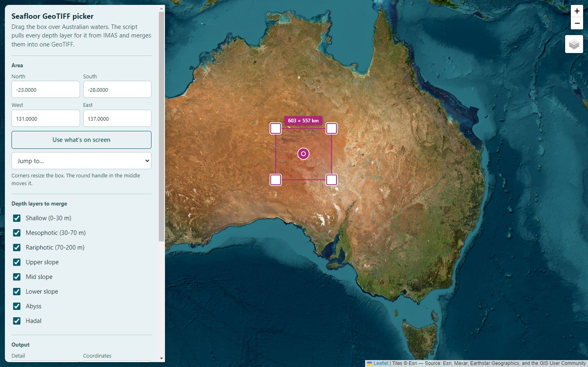
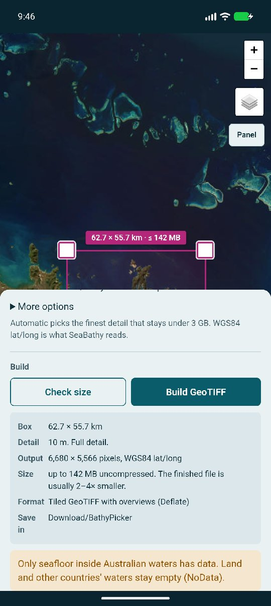
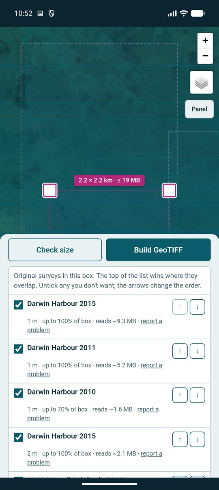
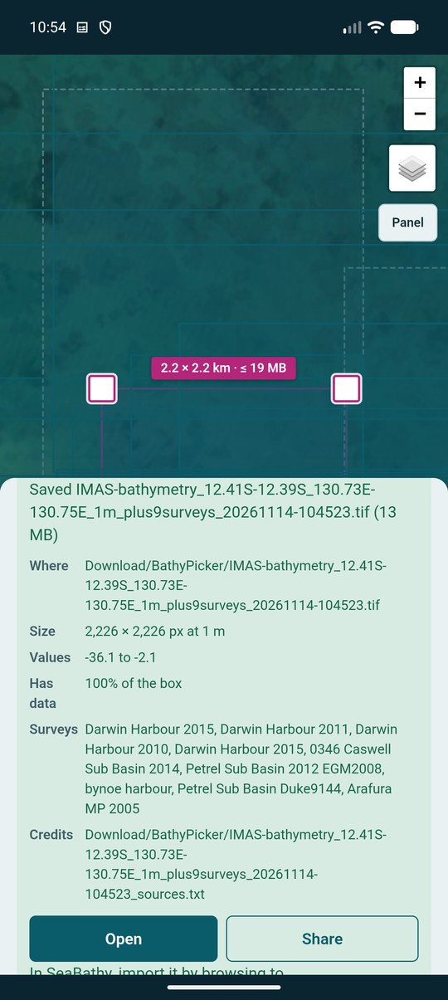
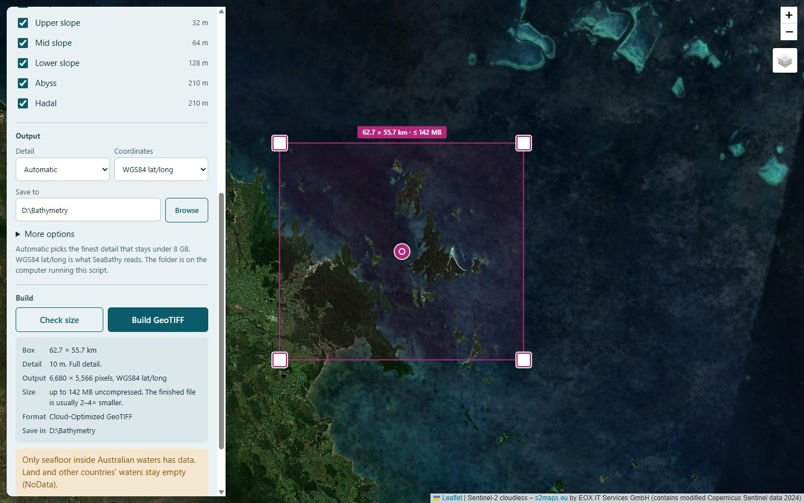
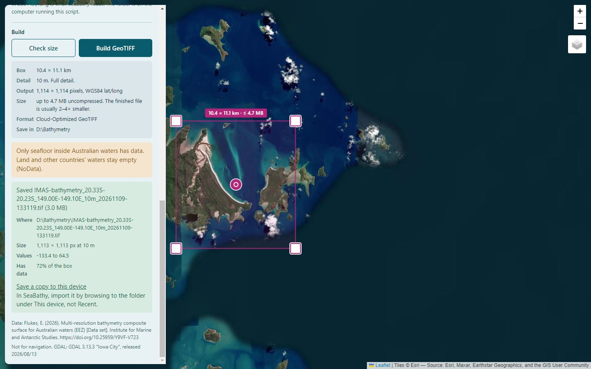
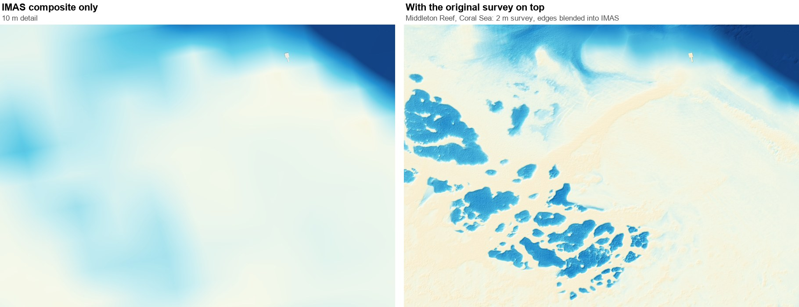
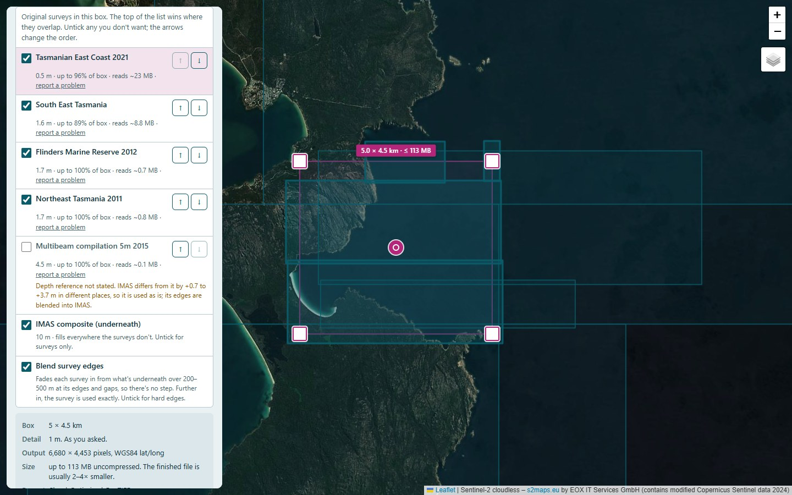
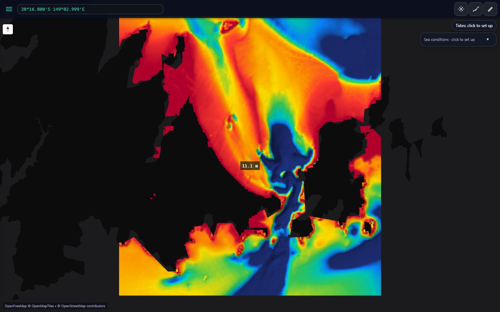
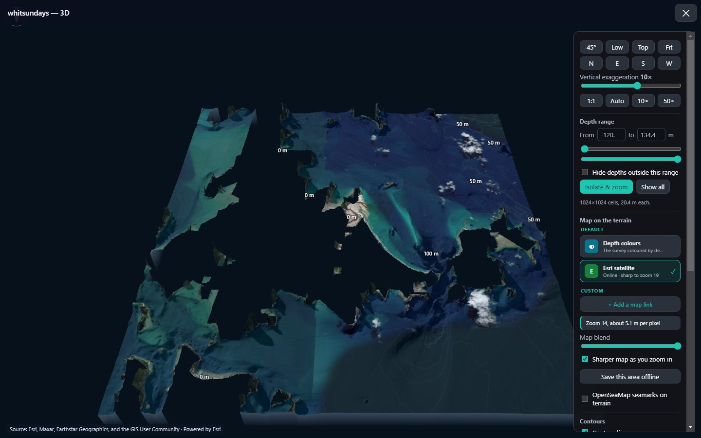

<h1 align="center">BathyPicker</h1>

<p align="center"><b>High-detail seabed maps of anywhere in Australian waters.</b><br>
Draw a box, get one depth GeoTIFF: 10 m detail along the coast, and down to 0.5 m wherever an
original survey exists. Free and open source.</p>

<p align="center">
  
  
  
  
  
</p>

<p align="center"></p>

The Institute for Marine and Antarctic Studies (IMAS) has published depth data for all of
Australia's waters, down to 10 m detail along the coast. It's a superb dataset, but it's
about 94 GB in 8 huge files. BathyPicker lets you draw a box on a map and downloads **just
that area**, merging every depth zone into one ready-to-use GeoTIFF. A bay takes seconds.

**New in 1.2:** where the original multibeam survey is finer than IMAS (about 120 surveys around
Australia, 0.2–7 m), BathyPicker lays it on top, so reefs, ledges and gutters show at full detail.
The survey's edges are blended into IMAS, so there's no step where it ends.

The result opens in [SeaBathy](https://github.com/SeaBathy/seabathy-android), QGIS and
most mapping software. It runs on a computer, or as an [Android app](#android-app) that
builds the file right on your phone.

> **Not for navigation.** This is survey data for planning and interest, not a nautical chart.

**New here?** The [how-to guide](https://seabathy.com/guide) shows the whole path in a few minutes: get a free depth file with BathyPicker, open it on your phone or PC, and put it on your chartplotter with AT5 Chart Maker.

## Contents

- [Features](#features)
- [Download and run](#download-and-run)
- [Android app](#android-app)
- [How to make a GeoTIFF](#how-to-make-a-geotiff)
- [Original surveys on top](#original-surveys-on-top)
- [What you get](#what-you-get)
- [Use your GeoTIFF](#use-your-geotiff)
- [Command line](#command-line)
- [Build the exe yourself](#build-the-exe-yourself)
- [Data, credits and licences](#data-credits-and-licences)

## Features

| | |
|---|---|
| 🗺️ **Pick on a map** | Drag a box over any Australian waters on a satellite or street map, type the corners, or jump to a preset. |
| 🧩 **One merged file** | All 8 depth zones (shallow, mesophotic, rariphotic, upper, mid and lower slope, abyss, hadal) merged into a single Cloud-Optimized GeoTIFF. |
| 🔍 **Original surveys on top** | Where a finer survey exists (0.2–7 m), it goes on top of IMAS. You choose which, and in what order. On the computer and the phone. |
| 🪡 **No steps at survey edges** | Each survey fades into what's underneath over 200–500 m at its edges, so there's no cliff where it ends. Further in, its depths are exact. |
| ⚡ **Only what you need** | Streams just your box from the IMAS and AusSeabed servers, never whole files. |
| 📏 **Sensible sizes** | *Check size* shows the pixels and file size first. *Automatic* detail picks the finest that fits under 8 GB. |
| 📝 **Credits included** | Every GeoTIFF gets a `_sources.txt` file listing the data used, for the CC BY 4.0 credit. |
| 🧭 **Your choice of coordinates** | WGS84 lat/long (what SeaBathy and most apps read) or GDA2020 Australian Albers (metres). |
| 📱 **Android app** | The same map as a phone app, original surveys and blended edges included. Builds the GeoTIFF on the phone, saves it to Downloads and opens it straight in SeaBathy. |
| 🔧 **Nothing to install** | A single Windows exe, or one Python file with no packages. GDAL is set up for you the first time. |

## Download and run

**Windows:** download **[`BathyPicker.exe`](download/BathyPicker.exe)** and double-click it.

- A small black window opens (leave it open) and the map page opens in your web browser.
- The first time, Windows may say *"Windows protected your PC"*, because the exe isn't
  signed by a big company. Click **More info**, then **Run anyway**.
- To stop it, close the black window.

**Android:** download **[`BathyPicker.apk`](download/BathyPicker.apk)** on your phone and tap it.
See [Android app](#android-app) below.

**macOS, Linux or Windows with Python 3.8 or newer:**

```bash
python3 bathy_picker.py
```

No packages to install. It uses only Python's standard library.

<details>
<summary><b>About GDAL (set up for you)</b></summary>

BathyPicker uses GDAL's `gdalinfo` and `gdalwarp` to read and merge the data. If GDAL isn't
on your computer, the page offers to download a private copy the first time: a few hundred
MB, once, about a minute, with no admin rights needed. It goes in its own folder
(`%LOCALAPPDATA%\bathy_picker` on Windows) and changes nothing else. It comes from the
[micromamba](https://mamba.readthedocs.io) installer and conda-forge's `libgdal-core`.

Or install GDAL yourself: `sudo apt install gdal-bin` (Ubuntu/Debian), `brew install gdal`
(macOS), or QGIS / OSGeo4W (Windows).
</details>

## Android app

The same page as a phone app, for Android 7.0 or newer, with the
[original surveys](#original-surveys-on-top) and their blended edges, just like the computer
version. Draw your box, press *Check size*, tick the surveys you want, then *Build GeoTIFF*. The
file is saved in **Download/BathyPicker** with its `_sources.txt` credits, and *Open* or *Share*
sends it straight to SeaBathy or anywhere else.

<p align="center">
  
  
  
</p>

- **Install:** download [`BathyPicker.apk`](download/BathyPicker.apk) on the phone and tap it.
  Android asks to allow installs from your browser or file app the first time: tap
  **Settings**, turn on **Allow from this source**, go back and tap **Install**. If Play Protect
  says it doesn't recognise the app (it isn't from the Play Store), tap **More details**, then
  **Install anyway**.
- **No GDAL needed.** The app has its own small engine that reads just your box from IMAS and
  the surveys, reprojects it, and merges and blends the layers the way the computer version's
  GDAL does. Its files were checked pixel by pixel against GDAL in 26 test boxes across every
  state, with blended and hard edges, and with 9 surveys stacked at Darwin: the same pixels
  filled, and the same depths to within about a millimetre (mostly within 0.1 mm). See
  [`android/`](android) for how.
- **One survey needs the computer version:** Zeehan and Franklin Marine Parks (west Tasmania)
  uses a compression the phone can't read, so the app lists it but leaves it out.
- **Size limit 3 GB** (8 GB on a computer). *Automatic* detail picks the finest that fits.
- **Keeps going in the background** with a progress notification, even with the screen off.
  *Cancel* leaves nothing behind.
- In SeaBathy, import the file by browsing to **Download/BathyPicker** under *This device*.

The source and how to build it are in [`android/`](android). You can also still run BathyPicker
on a computer and open its page from your phone with `--host 0.0.0.0` (see
[Command line](#command-line)).

## How to make a GeoTIFF

| | |
|---|---|
| **1. Draw your box.** The map opens on the whole of Australia. Drag the box over any waters by its round handle and pull the corners, or pick a place from *Jump to*. Untick any depth zones you don't want. |  |
| **2. Press *Check size*.** It shows the detail, pixels, file size and where the file will be saved. Big areas step down in detail by themselves. If original surveys cover the box, they're listed too (see [below](#original-surveys-on-top)). |  |
| **3. Press *Build GeoTIFF*.** A small area takes seconds. The result shows the file, its depth range and how much of the box has data. |  |

Files are saved in `bathy_exports` in your user folder unless you choose another folder on
the page. Next to each GeoTIFF is a `_sources.txt` file with the credits for the data in it.

## Original surveys on top

IMAS is 10 m at best. Many places around Australia were surveyed in much finer detail, and
those surveys are free to use (CC BY 4.0) on [AusSeabed](https://www.ausseabed.gov.au)'s public
download site. BathyPicker keeps a list of about 120 of them that are finer than IMAS and lays
the ones in your box on top. It reads just your box from each survey; nothing is stored by
SeaBathy. It works the same on the computer (Windows exe or Python) and in the Android app.

<p align="center"></p>

<p align="center"></p>

**In *Check size*:**
- **The surveys in your box are listed**, with their detail, how much of the box they cover and
  how much will be downloaded. Their outlines show on the map; hover a row to highlight it.
- **The top of the list wins** where surveys overlap. Finest and newest come first; use the
  **↑ ↓** arrows to change the order.
- **Untick** any survey you don't want. A few are unticked to start with (copies of another
  survey, or ones whose depth reference is uncertain); tick them if you want them.
- **IMAS composite (underneath)** fills everything the surveys don't. Untick it for surveys only.
- **Blend survey edges** (on by default): each survey fades in from what's underneath over
  200–500 m at its edges and gaps, so there's no step where it ends. Small surveys get a narrower
  band so their middle stays as surveyed. Beyond the band, the survey's depths are used exactly.
  Untick it for hard edges. Blending needs GDAL 3.11 or newer; the copy BathyPicker downloads is.
- Your choices are remembered for next time.

**Depth reference.** Surveys and IMAS are both meant to be on mean sea level, but not every file
is. Surveys that say they're on sea level (MSL, AHD or EGM2008) are used as they are. A few that
don't say are shifted to match IMAS, and the list shows by how much. Where a survey and IMAS
disagree by a metre or more, a note on its row says so. With blending on, that difference is
spread over the edge band instead of showing as a step.

**Detail.** With a survey ticked, *Detail* goes down to 0.5 m. *Automatic* picks the finest that
fits under the size limit, so big boxes still come out coarser.

**Something looks wrong?** Each row has a *report a problem* link that opens a GitHub issue with
the survey and your box filled in.

## What you get

The Whitsundays, built with BathyPicker and opened in
[SeaBathy Desktop](https://github.com/SeaBathy/seabathy-desktop): coloured by depth, then in
3D with satellite imagery draped over the seabed at Whitehaven Beach and Hill Inlet.

IMAS maps the seafloor only, so land in the file is empty. For the 3D picture, island
heights from [GMRT](https://www.gmrt.org) (free worldwide elevation, CC BY 4.0) were laid
under the IMAS depths with GDAL, so the satellite drapes over the hills too:

```bash
gdalwarp -te <west> <south> <east> <north> -tr <IMAS pixel size> gmrt.tif gmrt_grid.tif
gdalbuildvrt stack.vrt gmrt_grid.tif imas.tif      # IMAS on top wherever it has data
gdal_translate stack.vrt with-land.tif
```

<p align="center">
  
  
</p>

Only seafloor inside Australian waters has data. Land and other countries' waters are left
empty (NoData).

## Use your GeoTIFF

| Where | How |
|---|---|
| **Phone** | [SeaBathy for Android](https://github.com/SeaBathy/seabathy-android): **Settings → Load GeoTIFF**, then pick it from *Download/BathyPicker*. Or press **Open** in the BathyPicker app. Colour it by depth, fly over it in 3D, use it offline. |
| **PC** | [SeaBathy Desktop](https://github.com/SeaBathy/seabathy-desktop): drag the file onto the window. |
| **Chartplotter** | [AT5 Chart Maker](https://github.com/SeaBathy/AT5-Chart-Maker): drag the file in, press **Convert**, copy the folder to the SD card. Simrad, Lowrance and B&G units get a shaded depth picture and contour lines. |
| **GIS** | QGIS, ArcGIS, Global Mapper and anything else that reads GeoTIFF. |

For the plotter, a small depth range (such as 0–30 m) in AT5 Chart Maker shows reefs in the most
detail. For the phone, files up to a few hundred MB open quickly; bigger ones use SeaBathy's
built-in GDAL on 64-bit phones.

## Command line

Everything the page does also works without it. The exe takes the same options.

```bash
python3 bathy_picker.py --check                                    # test GDAL and the IMAS server
python3 bathy_picker.py --setup                                    # just download GDAL
python3 bathy_picker.py --bbox 148.70 -20.40 149.10 -20.10 --yes   # build a box, no map
python3 bathy_picker.py --help                                     # every option
```

| Option | What it does |
|---|---|
| `--res` | `auto` (default), `finest`, or a size in metres |
| `--zones` | Which depth zones, e.g. `shallow,mesophotic` (default all) |
| `--crs` | `wgs84` (default) or `albers` |
| `--out` | Folder for finished files |
| `--max-gb` | Size limit, default 8 |
| `--host 0.0.0.0` | Open the page from a phone on the same network (it prints a private link) |
| `--surveys` | With `--bbox`: `default` (the usual picks), `none` (IMAS only), or survey ids separated by commas, top first |
| `--no-base` | With `--bbox`: surveys only, no IMAS underneath |
| `--no-blend` | With `--bbox`: hard survey edges instead of blended ones |
| `--catalogue` | Use this survey list file instead of the online one |

Without `--yes`, a `--bbox` run prints the surveys in the box with their ids, so you can copy
them into `--surveys`:

```bash
python3 bathy_picker.py --bbox 148.30 -42.18 148.36 -42.14 --res 1          # list what's there
python3 bathy_picker.py --bbox 148.30 -42.18 148.36 -42.14 --res 1 --yes    # build it
```

## Build the exe yourself

```bash
pip install pyinstaller
pyinstaller --onefile --console --name BathyPicker --add-data "catalogue/surveys.json;catalogue" launcher.py
```

`launcher.py` starts `bathy_picker.py` unchanged. It only adds what a single exe needs, and
keeps the window open after an error so it can be read. The survey list goes inside the exe, so
it works offline; when online, BathyPicker fetches the newest list from this repository.

The survey list itself is made with `tools/build_catalogue.py`; see
[`tools/CATALOGUE.md`](tools/CATALOGUE.md).

## Data, credits and licences

- **Depth data:** Flukes, E. (2026). *Multi-resolution bathymetry composite surface for
  Australian waters (EEZ)* [Data set]. Institute for Marine and Antarctic Studies.
  https://doi.org/10.25959/Y9VF-V723. Licensed
  [CC BY 4.0](https://creativecommons.org/licenses/by/4.0/): credit IMAS when you share
  files you make with it. The page shows this citation with every build.
- **Original surveys:** © Commonwealth of Australia (Geoscience Australia) and the survey's
  makers, from AusSeabed, licensed [CC BY 4.0](https://creativecommons.org/licenses/by/4.0/).
  Each GeoTIFF's `_sources.txt` names every survey used, with its link. Not for navigation.
- **Map in the page:** Sentinel-2 cloudless by EOX (CC BY-NC-SA 4.0) and OpenStreetMap, credited on
  the map, drawn with [Leaflet](https://leafletjs.com) (BSD 2-Clause), which is included in the Android
  app. **Your own map link** in the map's layer menu adds any other tile map (Esri's, for example) under
  your own terms with that provider.
- **GDAL** (MIT), downloaded on first use if needed, not included here. The Android app doesn't use it.
- **The exe** is built with [PyInstaller](https://pyinstaller.org) and includes Python (PSF licence).
- **BathyPicker's code:** MIT licence, see [LICENSE](LICENSE).
- **Full licence texts and notices** for everything above: [THIRD_PARTY_NOTICES.md](THIRD_PARTY_NOTICES.md) and the [`licenses`](licenses) folder.

BathyPicker is an independent project, not made or endorsed by IMAS, the University of
Tasmania, Geoscience Australia or AusSeabed.

Also from SeaBathy: [SeaBathy for Android](https://github.com/SeaBathy/seabathy-android),
[SeaBathy Desktop](https://github.com/SeaBathy/seabathy-desktop) and
[AT5 Chart Maker](https://github.com/SeaBathy/AT5-Chart-Maker).
